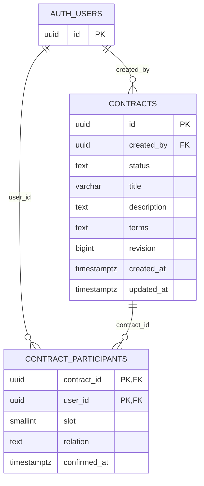

# M2-B3-P1 — Diseño del modelo de datos y seguridad RLS de contratos

**Estado:** DISEÑO ELABORADO — PENDIENTE DE REVISIÓN EXTERNA. Es una propuesta, no una migración ni una autorización de implementación. No se consultó ni modificó el proyecto Supabase remoto. El alcance inicial recomendado es persistir borradores privados del creador; compartir, aceptar, firmar y publicar evidencia requieren decisiones y controles posteriores.

## 1. Objetivo y alcance

Definir un modelo PostgreSQL para acuerdos de dos partes y la frontera de autorización de cada lectura y escritura. El objetivo inmediato es que un borrador propio pueda guardarse sin que otro usuario lo consulte o cambie por URL o API directa. La identidad autenticada procede de Supabase Auth; la relación con un contrato debe existir en datos confiables del servidor. El diseño contempla la evolución hacia contraparte, invitaciones, versiones y evidencia, sin presentarlas como funciones existentes.

## 2. Estado actual del proyecto

M0, M1 y M2-B1 están completados; M2-B2 está completado y aprobado técnicamente. AuthProvider observa sesiones, `RequireAuth` protege visualmente `/panel`, `/contratos/nuevo` y `/contratos/:id`, y el cliente usa una clave publicable. Ninguno de esos controles autoriza filas. No hay tablas, migraciones, RLS contractual, Storage de contratos ni operaciones Stellar/Soroban implementadas. La renovación remota real de tokens sigue sin observación directa. Este plan inicia M2-B3 en fase de diseño; P2 no está autorizado.

## 3. Funcionalidad de contratos existente

| Pantalla | Dato o concepto | Implementación actual | Persistencia futura | Sensibilidad | Almacenamiento recomendado | Decisión pendiente |
| --- | --- | --- | --- | --- | --- | --- |
| `/panel` | Lista y estado de acuerdos | Texto de estado vacío y enlaces; ninguna consulta | Sí | Privada | Proyección mínima desde contratos autorizados | Qué estados se listan |
| `/panel` | Aprobaciones/evidencia | Capacidades futuras en tarjetas, sin datos | Eventual | Privada o divulgación limitada | Entidades posteriores, nunca texto inventado | Qué se considera aprobación/evidencia |
| `/contratos/nuevo` | Título (máx. 120), descripción, cláusulas | Siete campos controlados; validación local; nada se guarda | Sí para borrador aprobado | Confidencial | Fila `contracts` privada; versiones futuras | Límites de longitud/edición |
| `/contratos/nuevo` | Nombre y correo de parte 1 y parte 2 | Texto local; exige dos correos distintos por comparación local | Solo tras decisión de flujo | Datos personales | Invitación/participación separadas, con minimización | Quién es creador y cómo se verifica contraparte |
| Revisión de borrador | Datos introducidos | Copia visual del estado React; desaparece al salir/recargar | No como entidad independiente | Confidencial | Leer borrador autorizado cuando exista | Qué constituye revisión/aceptación |
| `/contratos/:id` | Referencia de URL | `useParams` recorta a 120 caracteres para mostrarla; no consulta ni valida existencia | ID real futuro | Potencialmente sensible | UUID opaco y consulta RLS; respuesta neutral | Gramática de ID frente a allowlist actual |
| `/contratos/:id` | Título, fecha, estado, participantes | Etiquetas y «no disponible»; sin datos ficticios | Sí cuando se apruebe | Privada | Contratos y participación autorizada | Qué ve cada parte y desde cuándo |
| `/contratos/:id` | Billetera, aprobaciones, SHA-256, Stellar/Soroban | Solo textos de integración futura | Posterior | Privada; evidencia pública mínima eventual | Tablas de evidencia/artefactos separadas | Firma, cadena y divulgación |
| `/verificar` | Archivo elegido y huella ingresada | Nombre local del archivo y validación de 64 hex; no lee archivo ni calcula/compara hash | No para la UI actual | Archivo potencialmente confidencial | Procesamiento local futuro; registro público mínimo solo si se aprueba | Procedencia confiable de referencia y privacidad |

## 4. Datos identificados en el frontend

`CreateContractPage` maneja `title`, `description`, `participantOneName`, `participantOneEmail`, `participantTwoName`, `participantTwoEmail` y `terms`. `ContractDraftReview` recibe esos siete valores sin crear ID. `ContractDetailPage` solo muestra el segmento de URL, que no prueba existencia ni acceso. `VerifyDocumentPage` mantiene `File` y texto SHA-256 en memoria; una huella con formato correcto no demuestra igualdad. No hay datos de ejemplo que representen contratos persistidos, ni borradores en localStorage. Los nombres/correos escritos no verifican identidad legal y pueden no corresponder al usuario autenticado.

## 5. Requisitos funcionales observados

La UI contempla dos partes, título de hasta 120 caracteres, descripción y cláusulas no vacías; un borrador editable/revisable local; panel, detalle y verificación. El guard exige sesión para las tres rutas privadas, pero no define autorización por contrato. Para persistir el primer borrador hay que añadir asociación confiable con el creador, lectura propia, edición limitada y borrado según política aprobada. La UI aún no define guardado, invitación, aceptación, firma ni texto contractual canónico. La ruta de retorno admite `/contratos/` seguido de un segmento ASCII alfanumérico, guion o guion bajo de 1–120 caracteres; un UUID textual encaja, pero la URL no concede permiso.

## 6. Supuestos y decisiones pendientes

**Supuestos de diseño, no decisiones aprobadas:** un contrato tiene exactamente dos posiciones lógicas (1 creador, 2 contraparte); solo el creador autenticado guarda un borrador inicialmente; la contraparte adquiere lectura privada únicamente tras una aceptación verificada; el texto de borrador se almacena fuera de blockchain. Se propone no persistir los nombres/correos escritos en el formulario hasta decidir invitaciones y privacidad. Esto requiere adaptar el flujo visual en un prompt posterior; P1 no modifica la UI. La semántica legal, identidad de las partes, eliminación de cuenta, conservación, invitaciones, aceptación, firmas y publicación se enumeran en la sección 27.

## 7. Modelo conceptual

Supabase Auth mantiene cuentas y sesiones; la aplicación referencia únicamente `auth.users.id` como sujeto autenticado. `contracts` contiene metadatos y contenido editable del borrador. `contract_participants` representa vínculos confirmados de cuentas, nunca un correo introducido ni un enlace abierto. El creador se registra en posición 1 y una contraparte verificada ocuparía la 2. Una invitación pendiente es otro concepto, sin fila de participante confirmada ni acceso al contenido. Las versiones inmutables, archivos y eventos de aceptación/evidencia se añaden antes de habilitar aceptación; un contrato finalizado debe apuntar a una versión congelada. Una huella detecta alteraciones del contenido exacto, no impide cambiarlas ni prueba quién aceptó.

## 8. Entidades mínimas propuestas

1. **`contracts`:** ID opaco, `created_by`, estado inicial `draft`, título, descripción, cláusulas, revisión y marcas temporales. Solo borradores privados en la primera implementación.
2. **`contract_participants`:** relación entre contrato y cuenta confirmada, posición 1 o 2. La creación de la fila del creador debe ser atómica con `contracts`; la posición 2 queda vacía hasta un flujo de vinculación aprobado. Si P2 se limita a borradores privados y no puede garantizar esa atomicidad, debe posponer esta tabla y usar `created_by` para acceso, sin fingir que ya hay dos participantes.

No se propone tabla paralela de credenciales ni duplicar contraseñas. `full_name` de Auth y los correos del formulario no sirven como autoridad de acceso.

## 9. Entidades futuras opcionales

| Entidad | Cuándo sería necesaria | Límite antes de aprobarla |
| --- | --- | --- |
| `contract_invitations` | Envío y aceptación de contraparte | No otorga lectura de contrato por sí sola; token protegido y flujo transaccional |
| `contract_versions` | Primera aceptación o firma | Copia inmutable de bytes/texto canónico y huella con procedencia verificable |
| `contract_documents` | Archivos adjuntos | Metadatos y ruta de objeto privado; Storage con políticas propias |
| `contract_events` | Auditoría de transiciones | Inserción controlada y sin UPDATE/DELETE cliente; no sustituye firma verificable |
| Proyección pública de verificación | Referencia publicable aprobada | Sin documento, correos, nombres ni confirmación indiscriminada de existencia |

Ninguna entidad opcional integra Stellar o Soroban hoy. No se crea una tabla de perfiles salvo necesidad funcional independiente.

## 10. Esquema relacional propuesto

Todos los nombres/tipos son candidatos para migraciones futuras; **no hay SQL ejecutable aquí**. Timestamps usan `timestamptz`, IDs usan `uuid` aleatorios para reducir predictibilidad (sin tratarlos como control de acceso). Referenciar solo la PK `auth.users.id` coincide con la [guía de Supabase Auth](https://supabase.com/docs/guides/auth/managing-user-data). La política de borrado de cuentas debe aprobarse antes de fijar las FK: `RESTRICT/NO ACTION` preserva trazabilidad pero puede bloquear eliminación; `CASCADE` puede destruir contratos. No elegirla silenciosamente.

| Tabla | Columnas candidatas: tipo, nulidad y valor inicial | PK/FK, unicidad y relaciones | Índices propuestos | Sensibilidad y autorización |
| --- | --- | --- | --- | --- |
| `contracts` | `id uuid NOT NULL` generado en DB; `created_by uuid NOT NULL`; `status text NOT NULL DEFAULT 'draft'`; `title varchar(120) NOT NULL`; `description text NOT NULL`; `terms text NOT NULL`; `revision bigint NOT NULL DEFAULT 1`; `created_at timestamptz NOT NULL DEFAULT now()`; `updated_at timestamptz NOT NULL DEFAULT now()` | PK `id`; FK `created_by → auth.users.id` con acción de borrado pendiente; CHECK de estado limitado inicialmente a `draft`, título/contenido no vacíos y revisión positiva | `(created_by, created_at DESC)`; índice por `status` solo si consultas reales lo justifican | Título, descripción y cláusulas son privados; lectura por creador o vínculo confirmado; escritura de borrador solo del creador y columnas aprobadas |
| `contract_participants` | `contract_id uuid NOT NULL`; `user_id uuid NOT NULL`; `slot smallint NOT NULL`; `relation text NOT NULL`; `confirmed_at timestamptz NOT NULL DEFAULT now()` solo al confirmar vínculo | PK compuesta `(contract_id, user_id)`; FK contrato con borrado contractual controlado; FK usuario a `auth.users.id` con acción pendiente; UNIQUE `(contract_id, slot)`; CHECK slot 1 o 2 y relación coherente (`creator`/`counterparty`) | `(user_id, contract_id)` para listar vínculos; PK ya cubre `contract_id` | Revela asociación entre personas y acuerdos; ninguna escritura directa por cliente; creador inicial y contraparte solo por flujo confiable |

`confirmed_at` del creador es hora de vínculo de cuenta, **no** aceptación de términos. `updated_at` debe asignarse por servidor, no por el navegador. El límite de dos posiciones surge del CHECK del slot más UNIQUE `(contract_id, slot)`; no garantiza por sí solo que exista la posición 1 ni que slot 2 sea una contraparte válidamente invitada. La transacción/función de creación y las reglas de vinculación deben garantizarlo. Un CHECK no puede comprobar otras filas de forma fiable; véanse las [restricciones PostgreSQL](https://www.postgresql.org/docs/current/ddl-constraints.html).

## 11. Diagrama entidad-relación

Las tablas futuras de la sección 9 no forman parte de este diagrama mínimo ni de P2 por defecto.

## 12. Restricciones e índices

Conservar `title` ≤120 para concordar con la UI; añadir límites de tamaño a descripción/cláusulas tras decisión de producto y prueba de rendimiento. `UNIQUE(contract_id, slot)` y PK compuesta impiden dos cuentas en un slot o duplicar la misma cuenta; el CHECK del slot limita a dos posiciones. La combinación `slot=1 ↔ relation=creator` y `slot=2 ↔ relation=counterparty` es candidata para CHECK local; que `slot=1.user_id = contracts.created_by` requiere transacción/control entre tablas. No permitir cambio de `created_by`, slot, `user_id` o relación por UPDATE de navegador. Revisar índices con planes reales, especialmente `created_by`, `user_id` y FKs. Si la cuenta se elimina, definir retención/anonimización y almacenamiento legal antes de elegir CASCADE/RESTRICT. UUID no evita enumeración mediante respuestas, tiempos o metadatos.

## 13. Ciclo de vida contractual

| Fase propuesta | Disponible hoy | Primera persistencia | Condición para habilitarla después |
| --- | --- | --- | --- |
| Crear, editar y revisar borrador | Solo estado React local | `draft` privado, revisión optimista | Autorizar guardado/borrado y mapear campos de participantes |
| Preparar para compartir | No | No | Congelar versión compartible y definir visibilidad |
| Invitar y confirmar participación | No | No | Invitación verificable, uso único, aceptación transaccional |
| Revisar y aceptar contenido | No | No | Versión inmutable, actor verificable, autorización propia y evidencia |
| Firmar/finalizar | No | No | Definición legal y autorización criptográfica verificable; no booleano de UI |
| Consultar historia | Placeholder visual | Solo borrador del creador | Política de conservación y eventos inmutables |

Inicialmente `status='draft'`; no se fija una enumeración final de estados. Tras aprobación, transiciones distintas deben usar operación específica sobre versión exacta. Evitar que un UPDATE genérico convierta un borrador en aceptado/firmado o cambie contenido aceptado. Conservar versión anterior y huella de bytes canónicos; el hash detecta cambios, no los impide. Una aceptación visual no constituye automáticamente una firma digital certificada ni sustituye a un notario.

## 14. Modelo de participantes

El creador es `created_by=auth.uid()` en una fila creada por servidor y, si se implanta la tabla de relación, ocupa slot 1 con `user_id` igual. El texto «Participante 1» del formulario no establece esa identidad. La contraparte ocupa slot 2 únicamente después de autenticarse y completar un vínculo aprobado; nombre y correo introducidos por el creador son pistas de invitación, nunca membresía. `UNIQUE(contract_id, slot)` limita plazas; PK compuesta impide duplicar cuenta. Rechazar autoinscripción, cambio de usuario/rol, alteración de `confirmed_at` y reemplazo de contraparte vía API directa. Cualquier reemplazo posterior exige decisión de negocio, revocación de invitación/vínculo y nueva versión o contrato si hubo aceptación. La baja de usuario y conservación contractual se deciden antes de fijar FK.

## 15. Modelo de invitaciones

`contract_invitations` es **opcional y posterior**, no parte del mínimo para guardar borradores. Candidatos: ID UUID; contrato y slot 2; correo normalizado como dato privado solo si se aprueba enviar invitaciones; hash de token de alta entropía, caducidad, estado, emisor, fecha de consumo y cuenta que la consumió. Nunca guardar token en claro ni usar correo como prueba automática de titularidad. El token prueba posesión del enlace, no identidad legal ni derecho automático al contenido; la aceptación requiere sesión vigente, vínculo verificable con la cuenta prevista y operación atómica que consume token y crea participación. La comprobación de correo confirmado puede formar parte de un flujo aprobado, pero no basta por sí sola para identidad legal.

| Escenario | Respuesta de diseño |
| --- | --- |
| Cuenta existente o futura | Mantener invitación pendiente sin acceso completo; asociar al `auth.users.id` solo al aceptar bajo controles aprobados |
| Correo equivocado | Permitir revocar antes de aceptar; no revelar contrato al destinatario equivocado |
| Caducidad/reutilización | Comparar hash y vencimiento en servidor; transición de uso único e idempotencia acotada |
| Enlace obtenido por tercero | No basta el enlace: cuenta autenticada vinculada y comprobación adicional; mensaje neutral |
| Rechazo/cambio de contraparte | Registrar estado/revocación y decidir si se permite volver a invitar; nunca editar slot confirmado libremente |
| Dos aceptaciones simultáneas | Bloquear fila/transacción, unicidad de slot y consumo; una gana y otra recibe resultado neutral |

Limitar intentos y evitar enumeración por respuesta, tamaño y tiempo observable en lo posible. No hay envío de correos, endpoints, tokens ni invitaciones implementados en P1.

## 16. Matriz de autorización

**Leyenda:** P = PERMITIDO PROPUESTO para futura función y condiciones del actor; D = DENEGADO PROPUESTO; V = REQUIERE VERIFICACIÓN ADICIONAL antes de conceder; F = PENDIENTE DE DECISIÓN FUNCIONAL, por defecto cerrado. Son propuestas, no permisos implementados. «Creador» y «contraparte» se evalúan frente al contrato pedido; invitado no verificado significa invitación pendiente sin participación. Un usuario con sesión caducada se trata como anónimo para datos privados.

| Operación | Visitante | Autenticado ajeno | Creador | Invitado pendiente | Contraparte confirmada | Participante finalizado | Sesión caducada |
| --- | --- | --- | --- | --- | --- | --- | --- |
| Listar contratos | D | P: solo propios | P: propios | D: privados | P: vinculados | P: propios históricos | D |
| Crear contrato | D | P: borrador propio | P: otro borrador | P: borrador propio | P: borrador propio | P: otro borrador | D |
| Leer contenido | D | D | P: propio | D | V: vínculo/estado | V: vínculo/retención | D |
| Editar borrador | D | D | P: draft propio | D | F | D | D |
| Eliminar borrador | D | D | F | D | D | D | D |
| Invitar contraparte | D | D | F | D | D | D | D |
| Ver invitación | D | D | F | V: identidad y vista mínima | D | D | D |
| Aceptar invitación | D | D | D | V: token/cuenta/estado | D | D | D |
| Rechazar invitación | D | D | D | V: identidad y estado | D | D | D |
| Modificar participantes | D | D | D | D | D | D | D |
| Modificar estado | D | D | D: directo | D | D: directo | D | D |
| Aceptar términos | D | D | V: actor/versión | D | V: actor/versión | D | D |
| Firmar | D | D | F | D | F | F | D |
| Consultar evidencias privadas | D | D | V | D | V | V | D |
| Descargar documentos privados | D | D | V | D | V | V | D |
| Verificar huella pública real | F | F | F | F | F | F | F |

La última fila es F hasta aprobar una proyección pública con procedencia y divulgación limitadas. La ruta `/verificar` actual solo valida formato y no consulta nada. «P» para crear/listar se limita a contratos propios, nunca a todos los de cualquier cuenta.

## 17. Diseño de políticas RLS

Habilitar RLS y revisar **grants** para cada tabla expuesta: una política no revoca privilegios de tabla preexistentes. `anon` no recibe operaciones contractuales; `authenticated` solo las autorizadas. La publishable key no crea identidad. `auth.uid()` es el sujeto de la petición y devuelve `NULL` sin sesión; comprobarlo explícitamente. `service_role` puede omitir RLS y nunca pertenece al frontend. En PostgreSQL, `USING` filtra filas existentes para SELECT/UPDATE/DELETE y `WITH CHECK` valida filas resultantes de INSERT/UPDATE; un UPDATE también necesita visibilidad SELECT. [RLS Supabase](https://supabase.com/docs/guides/database/postgres/row-level-security), [políticas PostgreSQL](https://www.postgresql.org/docs/current/ddl-rowsecurity.html).

| Tabla | SELECT | INSERT | UPDATE | DELETE | Controles adicionales y riesgo residual |
| --- | --- | --- | --- | --- | --- |
| `contracts` | `authenticated` con `auth.uid()` igual a creador o vínculo confirmado propio **y estado de visibilidad aprobado**; en primera fase solo creador | `WITH CHECK`: `created_by=auth.uid()`, `status='draft'`, campos admitidos; atribución y slot 1 en una transacción | `USING`: creador y estado existente `draft`; `WITH CHECK`: mismo creador y estado final `draft`; grant solo a columnas editables. No escribir `revision`/fechas desde cliente | Denegar al principio; si se aprueba, solo draft propio mediante operación controlada | RLS no compara OLD/NEW de columnas inmutables ni ejecuta flujo de aceptación; requiere grants, transición/versión y control de concurrencia |
| `contract_participants` | Usuario ve como mínimo su propia fila; lectura de la otra parte requiere vista/proyección autorizada | Sin INSERT directo para clientes; fila creador y contraparte mediante operación transaccional revisada | Sin UPDATE directo de usuario, slot, rol o confirmación | Sin DELETE directo; revocación requiere flujo aprobado | PK/UNIQUE/CHECK restringen cardinalidad; creación y correspondencia con `created_by` requieren control entre tablas |
| `contract_invitations` futura | No exponer token/hash; destinatario autenticado ve solo proyección mínima tras verificación; emisor ve estado acotado | Operación de invitación revisada; no INSERT arbitrario | Solo transición controlada de pendiente a aceptada/rechazada/revocada | Evitar DELETE cliente; retención definida | RLS no prueba posesión/caducidad/uso único bajo carrera por sí sola |
| `contract_versions` futura | Participantes autorizados según estado | Solo proceso de congelación de versión | Denegado | Denegado | Hash y contenido inmutables, referencia a versión exacta y procedencia |
| `contract_documents` futura | Metadatos por vínculo; distinguir de acceso al objeto | Carga autorizada y estado | Renombrar/reemplazar solo si se aprueba | Política de retención | Políticas Storage adicionales obligatorias |
| `contract_events` futura | Participantes según clase de evento y privacidad | Inserción controlada por transición confiable | Denegado | Denegado | Sólo append no equivale a inmutabilidad frente a administradores |

Para listar contratos por participación, la política de `contracts` puede consultar **solo la fila propia** de `contract_participants`, cuya política SELECT sea `user_id=auth.uid()`. Así se evita autorreferencia recursiva. Cualquier ampliación que haga a participantes consultar contratos y viceversa debe revisarse contra recursión y filtraciones; si se necesita una función `SECURITY DEFINER`, situarla fuera de esquemas expuestos, fijar `search_path`, calificar nombres, revocar EXECUTE público, concederlo mínimamente y verificar `auth.uid()`/contrato dentro de la función. No se propone crearla ahora. [Funciones Supabase](https://supabase.com/docs/guides/database/functions).

## 18. Controles adicionales fuera de RLS

- **Grants de tabla/columnas:** RLS filtra filas, no protege automáticamente `created_by`, `status`, `revision`, slot o rol frente a un UPDATE de fila autorizada. Revisar revocación de UPDATE de tabla y concesión solo de columnas editables; las [columnas en Supabase](https://supabase.com/docs/guides/database/postgres/column-level-security) advierten que un grant de tabla prevalece.
- **Restricciones SQL:** PK, FK, UNIQUE, CHECK local y NOT NULL para invariantes de una fila o slot. El máximo de dos slots no prueba participación legítima; un CHECK no lee otras filas con seguridad.
- **Transacciones/funciones revisadas:** crear contrato y vínculo del creador de forma atómica; aceptar invitación, fijar slot 2 y cambiar estado en una transacción; congelar versión y aceptar términos exactos. `SECURITY INVOKER` por defecto; `SECURITY DEFINER` solo si la revisión demuestra necesidad y con privilegios mínimos, `search_path` seguro, comprobación explícita de actor y pruebas de abuso.
- **Auditoría:** marcas temporales desde servidor y eventos de transición sin UPDATE/DELETE cliente; decidir retención y acceso de administradores. No confundir log con aprobación criptográfica verificable.
- **Respuestas:** un ID ajeno y uno inexistente deben producir respuesta pública indistinguible en contenido; no consultar por separado la existencia para personalizar el error. No prometer tiempos idénticos.

## 19. Protección frente a operaciones concurrentes

Una comprobación «hay un slot libre» seguida de INSERT separado permite carreras. La aceptación futura debe bloquear la invitación/contrato en una transacción y apoyarse en UNIQUE `(contract_id, slot)` y estado de uso único; tratar conflicto como resultado neutro. Un cliente debe enviar revisión esperada para editar borrador y el servidor incrementar `revision` atómicamente; dos ediciones sobre la misma revisión no deben sobrescribirse sin advertencia. Congelar versión, registrar aceptación y cambiar estado deben ser una transición transaccional respecto al contenido exacto. Considerar reintentos idempotentes con clave de operación según el flujo aprobado, sin asumir que SERIALIZABLE elimina todos los errores de unicidad. [Aislamiento PostgreSQL](https://www.postgresql.org/docs/current/transaction-iso.html).

## 20. Documentos y Supabase Storage

No hay archivos contractuales almacenados hoy. Si se aprueban adjuntos, usar bucket **privado** y un registro `contract_documents` que vincule contrato, versión, objeto, tipo/tamaño y huella; evitar nombres de archivo con datos personales en rutas públicas. La tabla de metadatos necesita RLS, pero el objeto requiere políticas propias de `storage.objects` para listar, descargar, subir, mover y borrar. La lectura debe comprobar vínculo actual y estado permitido. Una URL firmada permite acceso temporal a quien la posea: duración mínima, no registrarla en logs, no enviarla a terceros y evaluar revocación; una URL pública no es apta para contratos confidenciales. [Storage privado](https://supabase.com/docs/guides/storage/buckets/fundamentals), [control de acceso](https://supabase.com/docs/guides/storage/security/access-control).

## 21. Verificación pública y privacidad

`/verificar` hoy solo comprueba formato. Una futura referencia pública debe ser una **proyección separada y aprobada**, por ejemplo resultado de coincidencia sobre una huella y versión expresamente publicable, sin título, texto, nombres, correos, miembros ni ruta Storage. Incluso confirmar la existencia de una huella puede revelar que un documento conocido figura en el sistema; decidir si se exige identificador de evidencia no enumerable o prueba de posesión y limitar consultas. El SHA-256 de un texto predecible puede revelar su contenido por diccionario. Exigir procedencia confiable de la huella y comparación de bytes canónicos; una huella ingresada por el usuario no es autoridad. No exponer una vista privilegiada que omita RLS por accidente; PostgreSQL/Supabase requieren revisar seguridad de vistas (`security_invoker` si aplica). [Vistas Supabase](https://supabase.com/docs/guides/database/views).

## 22. Extensión futura hacia blockchain

Stellar Testnet es la red inicial prevista, sin fondos reales. Una futura referencia de transacción o contrato Soroban sería campo/entidad opcional de evidencia asociado a una **versión congelada y su hash**, con identificador de red y estado de verificación; nunca contenido contractual confidencial en blockchain. La huella detecta diferencias de bytes, no impide cambios físicos. Una aprobación debe basarse en autorización criptográfica verificable del actor y versión, no en un booleano enviado por React. Una firma blockchain no equivale automáticamente a firma digital certificada ni a acto notarial. Esta extensión no pertenece a P1 ni presupone integración existente.

## 23. Matriz de amenazas

**Propuestas no implementadas.** Severidad relativa al futuro uso con datos reales: A alta, M media, B baja. «Residual» describe lo que seguiría requiriendo revisión tras aplicar el control. Los identificadores T enlazan con la matriz de pruebas de la sección 24.

| ID | Riesgo e impacto | Control propuesto | Capa | Prueba futura | Residual | Severidad |
| --- | --- | --- | --- | --- | --- | --- |
| T01 | Autenticado lee contrato ajeno; confidencialidad | RLS por creador/vínculo confirmado | DB | S04,S06 | Error de helper/grants | A |
| T02 | Cambiar ID URL expone otro contrato | Autorización por fila, error neutral | DB/API | S07 | Metadatos/tiempos | A |
| T03 | REST directo omite UI | RLS y grants en toda operación | DB | S08,S35 | Exposición por vista/RPC | A |
| T04 | `created_by` falsificado asigna contrato a tercero | `WITH CHECK` y atribución servidor | DB | S09 | Función privilegiada defectuosa | A |
| T05 | Autoincluirse en contrato ajeno | Sin INSERT directo de participación | DB/flujo | S16 | RPC defectuosa | A |
| T06 | Cambiar rol/slot eleva acceso | Sin UPDATE directo; CHECK/UNIQUE | DB | S17,S23 | Privilegios de función | A |
| T07 | Aceptar por otra persona simula consentimiento | Actor+versión exacta y autorización criptográfica futura | Flujo/DB | S19,S37 | Identidad/legalidad | A |
| T08 | Enlace de invitación filtrado | Token de alta entropía, cuenta vinculada, vista mínima | Flujo | S19,S38 | Posesión de cuenta ajena | A |
| T09 | Invitación reutilizada otorga vínculo doble | Consumo atómico y UNIQUE | DB/flujo | S20 | Reintento concurrente | A |
| T10 | Invitación caducada sigue válida | Comprobar vencimiento en servidor | DB/flujo | S21 | Relojes y tolerancia | M |
| T11 | Correo equivocado divulga términos | Pendiente sin acceso completo; revocación | Flujo | S39 | Aviso de invitación mínimo | A |
| T12 | Editar contenido aceptado rompe integridad | Versión congelada y transición controlada | DB | S25 | Administrador privilegiado | A |
| T13 | Reasignar contraparte unilateralmente | Slot inmutable y proceso de revocación | DB/flujo | S24 | Reglas de negocio abiertas | A |
| T14 | Cambiar estado a firmado vía PATCH | Sin UPDATE estado; transición específica | DB | S26 | Función mal revisada | A |
| T15 | Borrar/alterar evidencia histórica | Sin UPDATE/DELETE cliente, retención | DB/auditoría | S27 | Administrador/backup | A |
| T16 | Listar metadatos privados | Proyección mínima y RLS en relaciones | DB/API | S06,S40 | Errores/logs | M |
| T17 | Enumerar UUID/huellas confirma existencia | Respuesta neutral, rate limit, proyección pública aprobada | API | S07,S30 | Diferencias temporales | M |
| T18 | Descargar archivo ajeno | Bucket privado + RLS `storage.objects` | Storage | S29 | URL firmada filtrada | A |
| T19 | Sesión expirada se usa como autenticada | `auth.uid()`/JWT validado por backend | Auth/DB | S31 | JWT emitido aún vigente | M |
| T20 | Dos escrituras concurrentes pierden cambios o duplican slot | Revisión CAS, transacción, UNIQUE | DB | S22,S36 | Reintentos/errores | M |
| T21 | Error diferencia ajeno e inexistente | Mensajes neutrales, no consulta lateral | API | S07,S40 | Tiempos observables | M |
| T22 | Verificación pública filtra existencia/PII | Proyección separada y divulgación aprobada | API/DB | S30 | Ataque de diccionario | A |
| T23 | `service_role` en cliente omite RLS | Secretos fuera de VITE/frontend; permisos de despliegue | Configuración | S32,S41 | Compromiso servidor | A |
| T24 | RLS incompleta/grants amplios exponen tablas | RLS+grants por tabla, prueba anon/usuarios/API | DB | S33–S35 | Nuevas tablas/vistas | A |

El guard React, la opacidad del UUID y una clave publicable no sustituyen esos controles. Las pruebas se diseñan para el futuro y no validan políticas inexistentes.

## 24. Matriz de pruebas futuras

**41 escenarios DISEÑADOS — NO EJECUTADOS.** A = creador autenticado, B = contraparte autenticada, C = cuenta sin relación, Ø = sin sesión. D = borrador de A, P = invitación pendiente, V = participación confirmada, F = contrato finalizado si se aprueba ese estado. En «usuarios» R significa cuentas reales de prueba propias en entorno controlado futuro; N significa que basta un fixture para la parte indicada, sin sustituir la prueba R de seguridad. API = llamada directa con JWT de prueba; DB = prueba de políticas/grants en base aislada; UI = navegador. Ningún caso autoriza crear cuentas o consultar datos reales ahora.

| ID | Precondición | Actor | Operación | Resultado esperado | Control evaluado | Método futuro | Usuarios | Riesgo |
| --- | --- | --- | --- | --- | --- | --- | --- | --- |
| S01 | Esquema protegido | A | Crear D propio | Una fila atribuida a A y vínculo inicial atómico si aplica | INSERT/atribución | API+DB | R | T04 |
| S02 | Sin sesión | Ø | Crear D | Denegado; cero filas | Grants/RLS | API+DB | N | T24 |
| S03 | D de A | A | Leer por ID | Solo D propio | SELECT | API+UI | R | T01 |
| S04 | D de A | C | Leer por ID | Sin contenido ni existencia diferenciada | SELECT/error | API | R | T01 |
| S05 | D de A y otros | A | Listar | Solo contratos autorizados | SELECT/índice | API+UI | R | T16 |
| S06 | D de A y C | C | Listar | Nunca obtiene D de A | SELECT/proyección | API | R | T01,T16 |
| S07 | D ajeno e ID inexistente | C | Cambiar ID URL | Respuestas públicas equivalentes | RLS/error | UI+API | R | T02,T17,T21 |
| S08 | D de A | C | GET/PATCH REST directo | Lectura y escritura denegadas | RLS/grants | API | R | T03 |
| S09 | Esquema protegido | C | INSERT con `created_by=A` | Denegado | WITH CHECK | API+DB | R | T04 |
| S10 | D de A | A | UPDATE `created_by=C` | Denegado | Grants/immutabilidad | API+DB | R | T04 |
| S11 | D de A | A | Editar título/contenido | Solo columnas permitidas; revisión aumenta | USING/WITH CHECK/CAS | API+UI | R | T20 |
| S12 | D de A | C | Editar | Denegado; bytes intactos | UPDATE USING | API+DB | R | T01 |
| S13 | D de A | A | Borrar | Resultado conforme a decisión aprobada; por defecto denegado | DELETE/retención | API | R | T15 |
| S14 | D de A | C | Borrar | Denegado | DELETE USING | API | R | T01 |
| S15 | D de A | A | Crear slot 1 | Una relación propia, atómica; no duplicada | Transacción/PK | DB+API | R | T05,T20 |
| S16 | D de A | C | INSERT participante propio | Denegado | Sin INSERT directo | API | R | T05 |
| S17 | V de A/B | B | Cambiar slot/rol/user_id | Denegado | Grants/UPDATE | API | R | T06 |
| S18 | P destinada a B | B | Aceptar tras verificar cuenta | Un vínculo confirmado, token consumido | Flujo/transacción | API+UI | R | T08,T09 |
| S19 | P destinada a B | C | Aceptar con enlace filtrado | Sin vínculo ni contenido | Actor+token | API | R | T07,T08 |
| S20 | P consumida | B | Reutilizar token | No crea otro vínculo; respuesta neutral | Uso único/UNIQUE | API | R | T09 |
| S21 | P vencida | B | Aceptar | Denegado sin divulgar contrato | Vencimiento servidor | API | R | T10 |
| S22 | P vigente | B en dos solicitudes | Aceptar simultáneamente | Un solo vínculo; segunda controlada | Bloqueo/UNIQUE | API+DB | R | T20 |
| S23 | Dos slots ocupados | A/C | Insertar tercer participante | Denegado | CHECK+UNIQUE/flujo | API+DB | R | T06 |
| S24 | V de A/B | A | Reasignar B por PATCH | Denegado; flujo de revocación separado | Inmutabilidad | API | R | T13 |
| S25 | F aprobado | A/B | Editar términos | Denegado; versión previa intacta | Estado/versión | API+DB | R | T12 |
| S26 | D de A | A | PATCH `status=firmado` | Denegado | Grants/transición | API | R | T14 |
| S27 | Evidencia existente | A/B | UPDATE/DELETE evidencia | Denegado; rastro conservado | Grants/append | API+DB | R | T15 |
| S28 | Archivo de A | A | Descargar | Solo objeto autorizado | Storage RLS | Storage+UI | R | T18 |
| S29 | Archivo de A | C | Descargar/listar/copy | Denegado en todas las operaciones | `storage.objects` | Storage API | R | T18 |
| S30 | Huella publicable/no publicable | Ø/C | Verificación pública | Solo respuesta mínima aprobada, sin PII/existencia reservada | Proyección/rate limit | API+UI | R | T17,T22 |
| S31 | JWT ausente/caducado | Ø | Leer/editar D | Denegado, sin usar estado React antiguo | Auth/RLS | API | R | T19 |
| S32 | Publishable key sin JWT | Ø | SELECT/INSERT tablas | Denegado; sin service_role en bundle | Grants/RLS/config | API+build | N | T23,T24 |
| S33 | D de A | C | UPDATE fila ajena | `USING` la excluye | UPDATE USING | DB+API | R | T24 |
| S34 | D de A | A | UPDATE con nueva fila inválida | `WITH CHECK` rechaza dueño/estado resultante | UPDATE WITH CHECK | DB+API | R | T04,T24 |
| S35 | Todas tablas expuestas | Ø/A/B/C | Enumerar grants y RLS; REST directo | RLS activa, grants mínimos, sin lectura cruzada | Configuración completa | DB+API | R | T03,T24 |
| S36 | D revisión 1 | A en dos clientes | Editar simultáneamente | Solo una revisión gana; otra conflicto | CAS/transacción | API | R | T20 |
| S37 | Versión aceptable | A simulando B | Aceptar términos por B | Denegado; actor y versión exactos | Transición/autoría | API | R | T07 |
| S38 | Enlace filtrado | C | Abrir/usar P | Solo vista mínima; sin contrato | Invitación/acceso | UI+API | R | T08 |
| S39 | Correo erróneo | Destinatario equivocado | Abrir P | Sin texto contractual; revocable | Divulgación mínima | UI+API | R | T11 |
| S40 | D ajeno/inexistente | C | GET detalle/metadatos | Sin diferencias informativas de cuerpo | Error/proyección | API | R | T16,T21 |
| S41 | Build/config futura | Revisor | Buscar claves administrativas en bundle/config | Ningún secreto o `service_role` expuesto | Gestión secretos | Build+inspección | N | T23 |

Los escenarios de invitación, versión, archivo, evidencia y finalización solo se ejecutarán si esas capacidades se aprueban e implementan. Para políticas RLS, probar tanto peticiones reales de API con A/B/C/Ø como pruebas aisladas de base; una prueba del guard no sustituye ninguna de ellas. No usar credenciales administrativas para simular usuarios ordinarios, porque eludirían RLS.

## 25. Plan de implementación incremental

Secuencia orientativa, **no autorizada por P1**:

1. Responsable aprueba decisiones mínimas de sección 27 y delimita P2. Si no se aprueba el flujo de contraparte, P2 debe limitarse a borradores privados del creador.
2. Preparar migración versionada revisable para esquema mínimo, grants y RLS **en la misma entrega transaccional o sin exponer tablas entre pasos**. Decidir acción FK de borrado de cuenta y si `contract_participants` puede crearse atómicamente; no publicar una tabla `public` legible antes de RLS.
3. Probar en entorno de desarrollo aislado PK/FK/CHECK/UNIQUE, grants, `USING`, `WITH CHECK`, anon/A/B/C y REST directo. Revisar recursión de políticas y planes/índices. Auditar privilegios de vistas y funciones.
4. Tras autorización separada, crear servicio TypeScript para borradores (`src/services/supabase/`), con resultado tipado y sin `service_role` en cliente. Integrar `/panel` para listar y `/contratos/nuevo` para guardar sin confundir datos del formulario con cuentas verificadas.
5. Integrar `/contratos/:id` con consulta RLS y respuesta neutral para ajeno/inexistente; añadir regresión de rutas, Auth y accesibilidad. No usar la URL para inferir permiso.
6. En bloques posteriores y sujetos a negocio aprobado: invitaciones/participación confirmada; versiones/aceptaciones; archivos Storage; evidencia/verificación pública; Stellar/Soroban. Cada extensión requiere migración, políticas y pruebas negativas propias.
7. Auditoría final de seguridad con dos cuentas vinculadas, una ajena y anon, incluyendo API directa, límites de divulgación y carreras. No cerrar el bloque por pasar solo build/lint o pruebas de UI.

**División mínima sugerida:** (a) esquema + RLS de borradores y pruebas DB/API, quizá dos prompts acoplados si el despliegue evita exposición intermedia; (b) servicio frontend; (c) panel; (d) creación; (e) detalle; (f) invitaciones si se aprueban; (g) auditoría. P2 es solo una propuesta; su alcance se confirma tras revisar P1.

## 26. Estrategia de reversión

Antes de una migración futura: copia/backup de entorno de desarrollo, inventario de tablas/políticas existentes, migración de ida y plan de reversión revisado. Si aún no hay datos, retirar únicamente objetos creados por la migración, después de verificar dependencias y ausencia de escrituras. Si ya hay contratos, **no** hacer DROP/CASCADE ni borrar cuentas/objetos por comodidad: deshabilitar nuevas escrituras o funciones afectadas, restaurar versión anterior de servicios/políticas mediante migración compensatoria que mantenga acceso denegado por defecto, conservar datos y preparar transformación inversa comprobada sobre copia. Revertir una política permisiva a denegación es prioritario si hay exposición; revisar logs y acceso potencial. Probar rollback con A/B/C/Ø antes de usarlo. Ningún rollback se ejecuta en P1.

## 27. Decisiones que requieren aprobación

**I = imprescindible antes de crear tablas/flujo mínimo; D = diferible, pero obligatoria antes de habilitar su capacidad.** Las recomendaciones son técnicas, no decisiones legales aprobadas.

| Decisión abierta | Prioridad | Recomendación y fundamento | Consecuencia si se pospone |
| --- | --- | --- | --- |
| Qué significa cada parte del acuerdo y quién es creador | I | Definir que el sujeto Auth que guarda es creador técnico; no equipararlo automáticamente con «participante 1» legal | No se puede mapear formulario a vínculo confiable |
| Múltiples contratos por cuenta | I | Permitir varios con índice por creador; es coherente con «Mis acuerdos» | Si se limita, hace falta regla/cuota servidor |
| Cuántos contratos abiertos | D | Empezar con límite operativo/rate limit, no restricción de negocio inventada | Riesgo de abuso/coste a vigilar |
| Quién edita borradores | I | Solo creador al inicio; ampliar con reglas/versiones después | No habilitar edición colaborativa |
| Cuándo deja de ser editable | I | Primera fase solo `draft`; congelar antes de compartir/aceptar | No implementar transición/aceptación aún |
| Cómo confirmar a la contraparte | D | Cuenta autenticada más invitación vinculada y control adicional; correo no prueba identidad legal | Posición 2 permanece vacía |
| Si puede cambiarse contraparte | D | No cambiar vínculo confirmado directamente; proceso de revocación/reinvitación | No ofrecer reemplazo |
| Invitaciones por correo | D | Aprobar aviso mínimo, caducidad, revocación y privacidad antes de almacenar/enviar | No persistir correo del formulario |
| Eliminación de borradores | I | Denegar inicialmente hasta política de retención; si se permite, solo propio y sin evidencia/aceptación | No mostrar acción borrar |
| Eliminación de cuenta y FK | I | Definir retención, privacidad y anonimización antes de elegir RESTRICT/CASCADE/SET NULL | No cerrar migración con acción arbitraria |
| Qué significa aceptar acuerdo | D | Actor autenticado, versión exacta y registro de autorización verificable | Sin aceptación implementada |
| Qué significa firmar y efecto legal | D | Revisión legal separada y autorización criptográfica verificable; no booleano ni presunción notarial | Sin firma implementada |
| Cómo versionar contenido | D | Congelar bytes canónicos y huella antes de primera aceptación | Solo borrador editable |
| Evidencia y retención | D | Definir qué evento es probatorio, acceso y conservación antes de tabla append | No declarar trazabilidad definitiva |
| Qué puede revelar `/verificar` | D | Proyección mínima opt-in; evaluar enumeración y ataques de diccionario | Mantener validación local de formato |
| Momento de Stellar/Soroban | D | Añadir tras modelo de versión/aceptación aprobado, en Testnet | Sin dependencia blockchain en esquema mínimo |
| Límites de descripción y cláusulas | I | Definir máximo servidor razonable antes de persistir texto libre | Migración P2 pendiente de límites |
| Mapeo de siete campos de la UI | I | Guardar título/descripción/cláusulas; no convertir correos/nombres en miembros sin flujo | UI debe explicar qué se guarda |

## 28. Criterios de aceptación del diseño

Para aprobar P1: revisar la auditoría de pantallas; aceptar o corregir supuestos de creador, dos slots y borrador privado; resolver decisiones I; confirmar columnas, FK de usuario, límites, transacción inicial y grants/RLS sin recursión; comprobar que políticas conceptuales cubren SELECT/INSERT/UPDATE/DELETE y que ninguna ruta API/Storage se confía a React; revisar invitaciones, versiones, aceptación y divulgación pública antes de autorizarlas; aprobar matriz de amenazas y 41 pruebas diseñadas; dividir P2 en un alcance seguro y reversible. Este documento no aprueba P2 ni prueba tablas inexistentes. **Estado de P1: DISEÑO ELABORADO — PENDIENTE DE REVISIÓN EXTERNA.**
